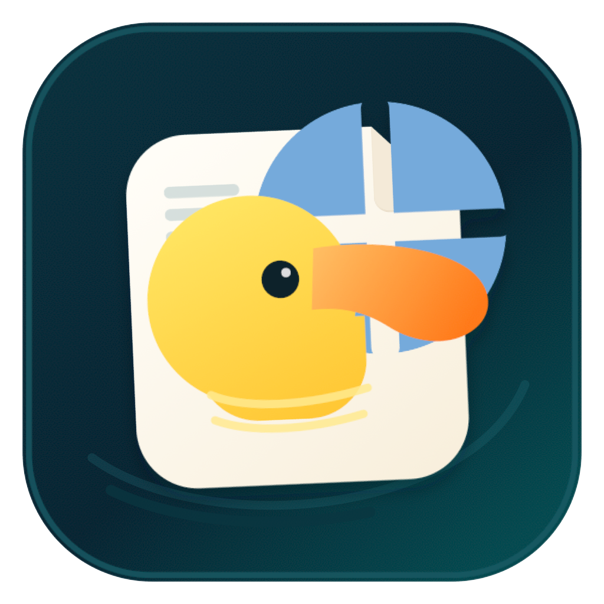

# DuckDB Report Studio

[](https://github.com/alexwoo79/duckdb-report/actions/workflows/ci.yml)
[](https://github.com/alexwoo79/duckdb-report/releases)
[](LICENSE)

<p align="center">
  
</p>

一个以 SQL 为中心的本地 DuckDB + Quarto 分析工作台。界面使用 Vue 3 + TypeScript，桌面壳与执行层使用 Go + Wails。桌面版只保留 SQL 与报告两个核心分析页面，减少配置负担，让注意力持续停留在找源文件、运行查询和生成数据表上。

## 能力

- 接入 CSV、JSON、Parquet、Excel（`.xlsx` / `.xlsm`）和 DuckDB 数据库。
- 数据资产按 database → schema → table/view 分层浏览，支持 attached database、只读状态和断开连接。
- “数据与分析资产”侧栏支持拖动、键盘方向键和双击恢复默认宽度，较长的表名可以完整展开。
- SQL 编辑、保存、执行与结果表格分页展示。
- SQL 编辑器支持 DuckDB 关键字、函数、表与字段补全，Tab 接受候选，以及运行、保存、搜索和注释快捷键。
- 查询结果支持全屏查看，并导出 UTF-8 BOM CSV 或压缩 Parquet 文件。
- QMD 编辑器支持 Quarto YAML、代码块选项、短代码和交叉引用补全，新建、另存以及 HTML/PDF 渲染快捷键。
- SQL/QMD 编辑器支持 `⌘/Ctrl + -/+` 调整字号；设置页支持 11–17px 界面字体大小。
- 手工分析路径固定为“打开 SQL → 运行并物化结果表 → 在 QMD 编写分析代码 → 生成 HTML/PDF”。
- 报告页不预设数据 SQL；Python、R、图表和最终表格代码全部由用户在 QMD 中维护。
- 报告同时保留 QMD、HTML/PDF、日志与 `analysis.duckdb` 快照，便于审阅和复用。
- macOS、Windows 与 Linux 发布包支持原生桌面运行，界面沿用 `duckui_notebook` 的图标与视觉风格。
- SQL 直接按编辑器内容执行，不维护额外参数栏；QMD 在报告运行目录直接读取 `analysis.duckdb`。
- SQL 中的 `COPY`、`read_csv`、`read_parquet`、`ATTACH` 等文件路径以当前工作区为基准解析；`.read` 继续相对当前 SQL 文件解析。
- SQL 与报告执行日志、独立产物目录和最近产物入口。
- 数据资产栏可直接切换工作区、打开工作区目录或导出数据库；设置页用于应用显示名、主题、界面字号和报告运行时状态。
- 工作区可导出为独立 `.duckdb` 发布快照，使用 R DuckDB 驱动可读取的兼容存储格式。
- 深色/浅色主题，布局延续 `duckui_notebook` 的三栏工作台和低干扰工具栏风格。

## 技术结构

```text
main.go / app.go    Wails 桌面入口与前端绑定
internal/cli        CLI 命令树与无界面工作区执行
internal/database   DuckDB 会话、数据导入、SQL 执行
internal/report     Quarto 渲染与报告表格生成
internal/runner     可选的 Workflow CLI 兼容执行层
internal/workspace  工作区、模板、参数与产物管理
internal/preview    受控 HTML/PDF 预览路由
frontend            Vue 3 + TypeScript + Vite
example             四表 Join → 汇总 → 透视 → Python/R 报告完整样例
```

依赖采用显式构造器手工注入，没有引入 DI 框架。工作台是单用户本地应用，SQL 与 QMD 被设计为可直接执行，因此不应作为多租户远程服务暴露。

## 安装

普通用户请从 [GitHub Releases](https://github.com/alexwoo79/duckdb-report/releases) 下载：

- `duckdb-report-v*-macos-universal.zip`
- `duckdb-report-v*-windows-amd64.zip`
- `duckdb-report-v*-linux-amd64.zip`

详细环境、Quarto、R、Python、PDF 中文字体及资源目录说明见 [安装文档](docs/INSTALL.md)。

## 源码构建环境

- Go 1.26+
- Node.js 20+
- Wails CLI 2.13+
- Quarto 1.8+
- PDF 默认使用 Quarto 内置 Typst；只有自定义 LaTeX 格式时才需要 LaTeX 发行版
- 示例提供 Python/Jupyter 与 R 两套 Quarto 报告
- Linux 构建需要 GCC、GTK 3 与 WebKitGTK 4.1 开发包；Ubuntu 24.04/Debian 13 可安装 `build-essential pkg-config libgtk-3-dev libwebkit2gtk-4.1-dev`

当前机器上的检测结果：

```text
DuckDB  v2.0.0 / go-duckdb v2.20000.0
Quarto  1.8.26
Wails   2.13.0
```

## 构建与运行

```bash
make          # 类型检查、测试并构建当前平台应用
make dev      # Wails 热重载开发
make test     # Go 测试 + Vue TypeScript 构建
make run      # 构建后打开应用
make build-cli # 构建独立 CLI
make build-linux  # 在 Linux 原生环境构建 x64 程序
make build-windows # 在 Windows 原生环境构建 x64 程序
```

输出：

```text
build/bin/duckdb_report.app
build/bin/duckdb_report.exe
build/bin/duckdb_report
build/bin/duckdb-report-cli
build/bin/duckdb-report-cli.exe
```

也可以直接使用：

```bash
wails build -trimpath -ldflags="-s -w"
wails build -platform linux/amd64 -tags webkit2_41 -trimpath -ldflags="-s -w"
wails build -platform windows/amd64 -trimpath -ldflags="-s -w"
```

Linux 默认使用 `webkit2_41` 构建标签，并通过 `GOTOOLCHAIN=go1.26.0` 固定已验证的 Wails 2.13 工具链。需要兼容仍只提供 WebKitGTK 4.0 的旧发行版时，可使用 `make build-linux LINUX_WEBKIT_TAGS=webkit2_40`，并在目标发行版上验证对应开发包。

GitHub Actions 的 `v*` 标签发布会分别编译 macOS Universal（Apple Silicon + Intel）、Windows x64 和 Linux x64。也可以手动触发 `Release` 工作流：默认上传三平台 snapshot ZIP，并创建 `snapshot-<short-sha>` 预发布页面；每个包都包含桌面程序、CLI、安装文档和同一提交的 `duckdb-sql-analytics` Skill。

## CLI 自动化

桌面二进制在带子命令时进入 CLI 模式；发布包同时提供独立的
`duckdb-report-cli`，避免 Windows GUI 子系统影响控制台输出。CLI 与 GUI
共用工作区、DuckDB 与 Quarto。Workflow 命令仅为旧工作区和自动化脚本保留兼容。

```bash
duckdb-report-cli --workspace /path/to/workspace status --json
duckdb-report-cli --workspace /path/to/workspace query \
  --file examples/monthly_sales/sql/01_join.sql --limit 100 --json
duckdb-report-cli --workspace /path/to/workspace doctor --json
duckdb-report-cli --workspace /path/to/workspace render \
  --template examples/monthly_sales/reports/monthly_sales_python.qmd \
  --format html --query "SELECT * FROM region_category_pivot" --json
```

主要命令：

- `status`：工作区、DuckDB、Quarto、R、Python、Jupyter、表和数据源状态。
- `query`：执行文件或内联 SQL，支持 `.read`。
- `doctor`：只读检查 SQL、QMD、资源路径和运行时；旧工作区仍会校验其兼容配置。
- `import`：导入 CSV、JSON、Parquet、Excel 或附加 DuckDB。
- `render`：渲染 QMD 为 HTML/PDF；QMD 直接读取运行目录中的报告快照。
- `workflow validate|run|import|export`：可选的旧版兼容命令，不作为日常分析入口。

`--json` 将机器可读结果写到 stdout，诊断和步骤进度写到 stderr；退出码 `0`
表示成功，`1` 表示运行错误，`2` 表示参数或命令使用错误。应用正在运行时不要用
CLI 并发写同一个 `workspace.duckdb`。

`doctor` 发现 error 时返回退出码 `1`；warning 默认不阻断，使用 `--strict`
可将 warning 也视为失败。它不自动修改 SQL 或业务口径。

## 工作区

默认工作区：

```text
macOS:   ~/Library/Application Support/duckdb_report/
Windows: %APPDATA%\duckdb_report\
Linux:   ${XDG_CONFIG_HOME:-~/.config}/duckdb_report/
```

可用环境变量切换：

```bash
DUCKDB_REPORT_HOME=/path/to/workspace wails build
```

目录内容：

```text
workspace.duckdb
data/
sql/
templates/
workflows/current.json  # 可选，仅旧版工作流兼容
runs/<run-id>/report.qmd
runs/<run-id>/report.html
runs/<run-id>/report.pdf
runs/<run-id>/quarto.log
exports/<package-name>.zip
examples/monthly_sales/
```

只有应用默认工作区会在首次启动时复制内置示例和月度销售样例。通过设置页选择的任意工作区不会被识别为示例工作区；应用只会在该目录创建按需使用的 `workspace.duckdb`，不会预建 `data/sql/templates/workflows/runs` 目录，也不会生成 `workflows/current.json`。

设置保存在独立文件：

```text
~/Library/Application Support/duckdb_report/settings.json
```

Windows 对应 `%APPDATA%\duckdb_report\settings.json`，Linux 对应 `${XDG_CONFIG_HOME:-~/.config}/duckdb_report/settings.json`。

通过数据资产栏选择新的工作区目录后会立即切换，并重新加载 SQL、QMD、数据库表和报告产物。用户选择的工作区只读取现有内容，不会注入内置示例、工作流或目录骨架；SQL、模板和报告目录只在用户保存或生成产物时按需创建。只有应用默认工作区会初始化示例资产。现有工作区数据不会自动迁移，需要时自行复制目录。通过 `DUCKDB_REPORT_HOME` 启动时，环境变量优先于设置文件中的工作区。

数据管理支持两种清理方式：

- 点击数据源旁的 `×` 只移除该导入表或外部数据库连接。
- “清空工作库”会删除当前工作库中的用户表、视图和外部连接；SQL、QMD 和报告文件不会删除。

数据资产栏中的“导出数据库”会生成完整工作库 `.duckdb` 快照，便于组合分析结果并作为发布数据交付。导出使用兼容存储版本，可供 R DuckDB 驱动和常见 DuckDB 客户端读取。

“数据与分析资产”中的导入行为：

- CSV、JSON、Parquet、Excel 会进入工作库 `workspace.duckdb`，成为可查询表。
- DuckDB 文件以外部 catalog 附加，不会复制数据库内容。
- 导入完成后直接生成可查询的数据表，不创建 Preset 或工作流步骤。

## QMD 运行时

QMD 不一定需要 R 或 Python：

- 纯 Markdown / HTML 报告不需要脚本运行时。
- 显式包含 ```` ```{r} ```` 代码块时，需要 Quarto 能找到 R/Rscript。
- 显式包含 ```` ```{python} ```` 代码块时，需要 Python 与 Jupyter。
- PDF 默认由 Quarto 内置 Typst 生成。
- PDF 中文字体会根据 macOS、Windows 或 Linux 自动选择，也可在 QMD 的 `params` 中覆盖。

报告页会实时识别当前 QMD 的依赖；缺少运行时时会禁用渲染按钮并说明替代方案。
QMD 在报告运行目录中直接打开自动生成的只读 `analysis.duckdb` 快照。

## 手工分析

桌面版的推荐路径不依赖 Workflow：

1. 在 SQL 页选择或新建 `.sql` 源文件。
2. 手工运行 SQL，并使用 `CREATE OR REPLACE TABLE` 将每个分析结果物化为可查询表。
3. 检查结果与质量问题，确定报告需要展示的最终结果表。
4. 选择 QMD，在脚本块中自行编写数据读取、计算和图表代码。
5. 在 QMD 中直接连接 `analysis.duckdb`，生成 HTML 或 PDF。

报告运行目录同时保留：

```text
runs/<run-id>/
  report.qmd
  report.html 或 report.pdf
  analysis.duckdb
  quarto.log
  assets/
```

`workflows/current.json` 及 `workflow` CLI 命令继续保留，用于读取旧工作区和兼容已有自动化脚本；桌面导航、侧栏和检查器不再暴露工作流配置。

## 验证

```bash
gofmt -w .
make test
```

在 Linux 上直接调用 Go 工具链时需带桌面后端标签：`go test -tags webkit2_41 ./...`。

当前测试覆盖：

- 可选 Workflow 的兼容校验与参数优先级
- `{{variable}}` 替换和路径越界防护
- DuckDB 多语句查询
- `.read` SQL 嵌套文件展开
- Excel 导入
- 报告表格 HTML 转义
- 旧版 `{{table}}` 兼容注入顺序
- 预览文件路由和目录穿越拦截
- 报告数据库快照与数据库发布包
- 跨平台 PDF 中文字体选择

## Agent 协作

推荐配合 [DuckDB SQL Analytics Skill](https://github.com/alexwoo79/skills_plugins/tree/main/codex-skills/duckdb-sql-analytics)
使用。Skill 负责定位 SQL 源文件、确认数据表、物化分析结果和生成 QMD 报告；桌面程序
提供实际的 DuckDB、Quarto 和结果审阅能力。

安装 Skill：

```bash
git clone https://github.com/alexwoo79/skills_plugins.git
mkdir -p "${CODEX_HOME:-$HOME/.codex}/skills"
cp -a skills_plugins/codex-skills/duckdb-sql-analytics \
  "${CODEX_HOME:-$HOME/.codex}/skills/"
```

典型 Agent 分析路径：

```text
$duckdb-sql-analytics
  → 定位工作区与 SQL 源文件
  → query 执行并物化各结果表
  → 检查表、行数和质量问题
  → render 生成 HTML/PDF
  → 用户按需在 GUI 审阅报告
```

对应命令：

```bash
duckdb-report-cli --workspace /path/to/workspace status --json
duckdb-report-cli --workspace /path/to/workspace doctor --json
duckdb-report-cli --workspace /path/to/workspace query \
  --file examples/monthly_sales/sql/03_pivot.sql --json
duckdb-report-cli --workspace /path/to/workspace render \
  --template examples/monthly_sales/reports/monthly_sales_python.qmd \
  --query "SELECT * FROM region_category_pivot" --format html --json
```

Agent 主要读写工作区中的：

- `sql/*.sql`
- `templates/*.qmd`
- `runs/<run-id>/`

CLI 适合自动化执行，GUI 适合人工审核、编辑和预览产物。运行前建议先检查
SQL/QMD 权限，因为该工作台刻意保留了本地分析工具的完整表达能力。
